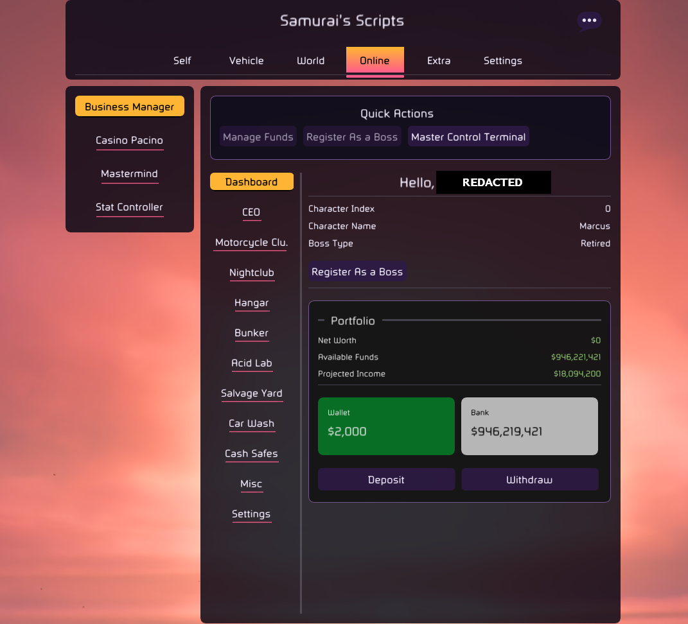

<!-- markdownlint-disable MD028 -->
<!-- markdownlint-disable MD033 -->
<!-- markdownlint-disable MD041 -->

  
  
  
  

  <h3>Supported Builds</h3>

  
   
  
  

  

  
<strong>Table of Contents</strong>

  <ul>
    <li><a href="#about">About</a></li>
    <li>
      <a href="#getting-started">Getting Started</a>
      <ul>
        <li><a href="#setup">Setup</a></li>
        <li><a href="#commands-console">Commands Console</a></li>
      </ul>
    </li>
    <li><a href="#contributing">Contributing</a></li>
    <li><a href="#documentation">Documentation</a></li>
    <li><a href="#features">Features</a></li>
    <li><a href="#faq">FAQ</a></li>
    <li><a href="#contact">Contact</a></li>
    <li><a href="#acknowledgments">Acknowledgments</a></li>
  </ul>

 

# About

A modular GTA V Lua framework focused on enhancing the player's experience through fun features, online business options, and unpopular opinions.

## Getting Started

### Setup

- Download the latest zip archive from the [releases section](https://github.com/YimMenu-Lua/Samurais-Scripts/releases/latest).
- Extract the archive and place the `SSV2` folder in YimMenu's `scripts` folder:

       %AppData%\YimMenu\scripts

- Once in-game, press **[F5]** to toggle the script's UI.

For the native YimMenuV2 Lua API, use **`SSV2-enhanced`** from the same release ZIP.
Copy its `samurais_v2.lua` and `includes/ssv2` directory into
`%AppData%\YimMenuV2\scripts`, then load `samurais_v2.lua`.

>[!Note]
> Releases are scheduled for Sundays at 8AM.

### Commands Console

- Use **[F4]** to toggle the console window.
- Type `!ls` or `!dump` to dump all available commands.
- All default commands are prefixed with an exclamation mark `<!>`.

## Contributing

Contributions are what make the open source community a great place to learn, inspire, and create. Any contributions you make are **greatly appreciated**.

If you have a suggestion that would make this project better, please fork the repo and create a pull request. You can also simply open a [feature request](https://github.com/YimMenu-Lua/Samurais-Scripts/issues/new?template=request.yml).

Don't forget to give the project a star!

1. Fork the repo
2. Create your feature branch.
3. Commit your changes.
4. Open a Pull Request.

Refer to the [Contribution Guidelines](./CONTRIBUTING.md) for more details on the project's structure and conventions.

## Documentation

This project was rewritten from scratch using the [SmallBase](https://github.com/xesdoog/SmallBase) template.

A full documentation will be uploaded to this repository soon. In the meantime, feel free to explore [SmallBase's docs](https://github.com/xesdoog/SmallBase/tree/main/docs).

>[!Note]
> Some parts of the API were refactored or extended but nothing has drastically changed.
> All changes introduced in this project are documented in the source.

## Features

A full list of available features and their usage [can be found here](docs/Features.md).

## FAQ

- **Q:** Does this support Enhanced?
- **A:** The `SSV2-enhanced` edition targets GTA V Enhanced and the native YimMenuV2 Lua API.

- **Q:** What is YimLuaAPI and how do I use it?
- **A:**
  - **What is it:** [YimLuaAPI](https://github.com/TupoyeMenu/YimLuaAPI) is a universal Lua API that works for both Legacy and Enhanced.
  - **How to use it:** Right now there is no release because it's still in development. If you want to try it, you have to compile it yourself. Once you have `YimLuaAPI.dll`, inject it into any GTA branch (Legacy/Enhanced), it will create a folder on first injection: `%AppData%\YimLuaAPI`. Simply place the script there and you're done. You can still use YimMenu/YimMenuV2 but the script has to only exist in YimLuaAPI.

- **Q:** Which edition runs in YimMenuV2?
- **A:** Use `SSV2-enhanced`. The original `SSV2` runtime uses Lua 5.4 and the V1/YimLuaAPI environment; the Enhanced edition uses LuaJIT and native V2 APIs. The release contains both editions so you can select the correct one.

## Contact

  

## Acknowledgments

| Name | Contribution |
| :---: | :---: |
| <a href="https://github.com/harmless05"> Harmless</a> | Shift-Drift |
| <a href="https://github.com/NiiV3AU"> NiiV3AU</a> | German translations |
| <a href="https://github.com/gir489returns"> gir489returns</a> | [Casino Pacino](https://github.com/YimMenu-Lua/Casino-Pacino) |
| <a href="https://github.com/tupoy-ya"> tupoy-ya</a> | Several contributions and shared knowledge. Owner of [YimLuaAPI](https://github.com/TupoyeMenu/YimLuaAPI) |
| <a href="https://github.com/szalikdev"> szalikdev</a> | Revived the project and joined the cause. Owner of [Acid Labs](https://github.com/acidlabsdev) |
| <a href="https://github.com/How-Bout-No"> How-Bout-No</a> | Enhanced compatibility (YimLuaAPI), Mastermind module, and more. |
| <a href="https://github.com/shinywasabi"> ShinyWasabi</a> | [scrDbg](https://github.com/ShinyWasabi/scrDbg) and other foundational community contributions frequently used as reference |
| <a href="https://github.com/durtyfree"> Alexander Schmid</a> | [GTA V data dumps](https://github.com/DurtyFree/gta-v-data-dumps) |
| <a href="https://github.com/yimura"> Andreas Maerten</a> | GTA V classes (archived/removed) |
| <a href="https://github.com/sch-lda"> sch-lda (SCH)</a> | [MiniGameHack](https://github.com/YimMenu-Lua/MiniGameHack) |
| <a href="https://github.com/TCRoid"> TCRoid (Rostal)</a> | [SoloMissions](https://github.com/YimMenu-Lua/SoloMissions) |
| <a href="https://github.com/tuyilmaz"> tuyilmaz</a> | Free Shopping |
| <a href="https://unknowncheats.me"> UnknownCheats</a> | A treasure trove of information |

## TODO

- [ ] Generate our own docs since we're no longer in sync with [SmallBase](https://github.com/xesdoog/SmallBase).
- [ ] Fully Refactor EntityForge.
- [ ] Add support in YimActions for defining custom animations. This will require extracting EntityForge's attachment handler into a reusable module for animation prop configuration.
